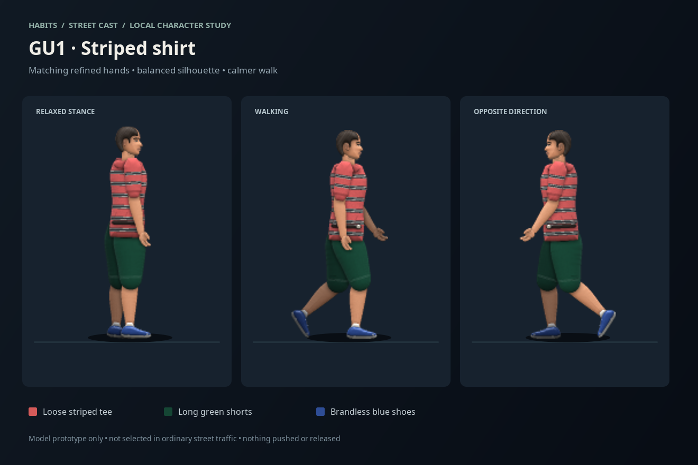
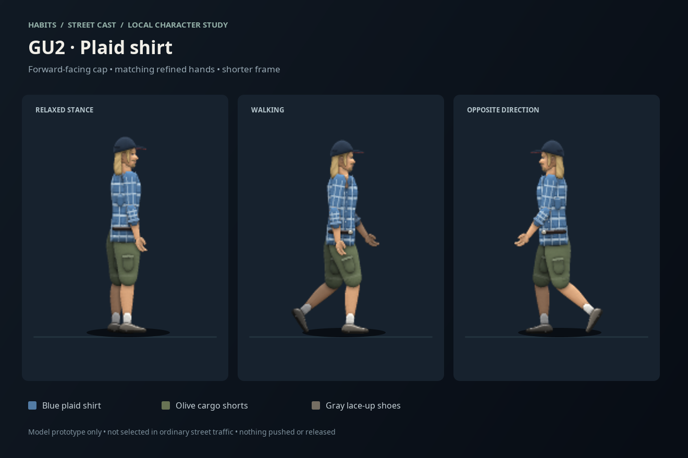
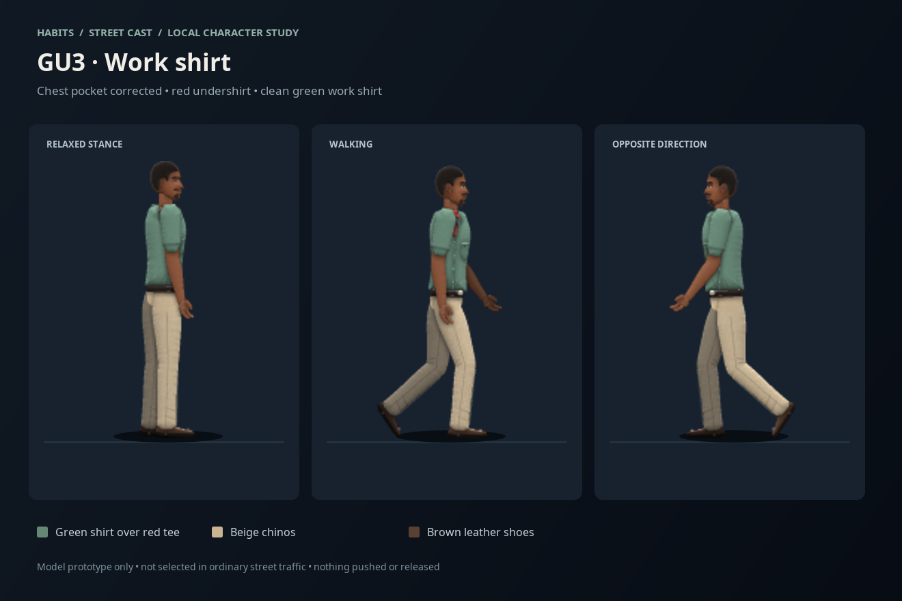
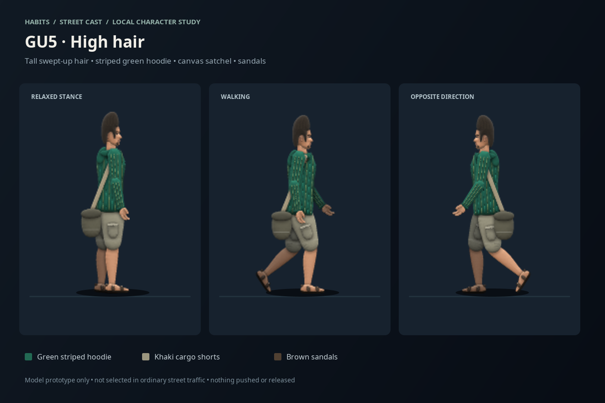

# GU pedestrian models — integration handoff

Five approved native pedestrian appearances, identified only as GU1–GU5. The branch contains
model geometry and tooling for integration; the models are not registered in ordinary city
traffic and no release or OTA is included.

| ID | Definition | Appearance |
| --- | --- | --- |
| GU1 | `StreetCameos.GU1` | Red striped shirt, green shorts, plain blue shoes, short dark crop |
| GU2 | `StreetCameos.GU2` | Blue plaid shirt, forward navy cap, long blond hair, olive cargo shorts |
| GU3 | `StreetCameos.GU3` | Green work shirt over red undershirt, beige trousers, brown shoes |
| GU4 | `StreetCameos.GU4` | Fuller build, blue/navy sports shirt, black shorts, gray shoes; no towel |
| GU5 | `StreetCameos.GU5` | Tall swept-up hair, green striped hoodie, khaki shorts, canvas bag, sandals |

## Source and integration

- Definitions: `android-wrapper/native/src/main/java/com/lifemax/rpg/feature/habits/domain/StreetCameos.kt`.
- Opt-in geometry, clothing, hair and shoes: `StreetRig.kt` in the same directory.
- `StreetRig.frame(StreetCameos.GU1, frame)` renders an explicit appearance without expanding the
  ordinary six-look cache. Each model has a custom calm gait and the same wrist-space hand size.
- All five match the approved previews, including GU2’s forward cap, GU3’s corrected chest
  pocket, GU4’s removed towel and GU5’s broad swept-up crown.
- Runtime group spawning, atlas/cache registration and separate-part scene painter integration
  are deliberately unfinished. Integrate these in the current Habits city code, retaining the
  appearance-specific `walkStyle`, hand scale and clothing behavior in every rendering path.
- Whole-figure previews exercise actual native rig/raster code. They do not establish that the
  city’s layered arm/head painter is already wired to the new variants.
- Avoid copying an older complete `StreetRig.kt` over newer city changes. Port/cherry-pick the
  opt-in additions and resolve against the current implementation.

The handoff commit is based on native baseline `851b574e803926c7a17c4431e86ae7e75a0e9c0b`.
The locally tested `Gait.kt`, `StreetGait.kt` and `StreetLife.kt` match that baseline. They are
not changed by this handoff. There are no unrelated gameplay, save or release changes.

## Validation and preview

40 local JVM scenario checks cover all 73 poses, finite geometry, grounded/planted feet,
restrained head movement, matching hand dimensions, garment details, connected hairstyles and
open sandals. Six original ordinary appearances remain unchanged. JUnit wrappers call the same
scenario objects. Local validation used Kotlin 2.0.0/JVM 21; project Kotlin is 2.0.21. An Android
build and device validation are still required when integrating into the live city.

```sh
python3 tools/preview_street_cameo.py --compiler-classpath "$KOTLIN_JARS" \
  --character GU1 --output /tmp/GU1
```

Repeat with GU2–GU5. The compiler and standard-library jars are supplied externally through
`KOTLIN_JARS` (and optionally `KOTLIN_STDLIB`); no machine-specific compiler jars are checked in.
The tool produces `character-study.png`, `walk.gif`, a 64-frame atlas and per-frame PNGs.

## Approved appearance previews

### GU1


### GU2


### GU3


### GU4


### GU5

