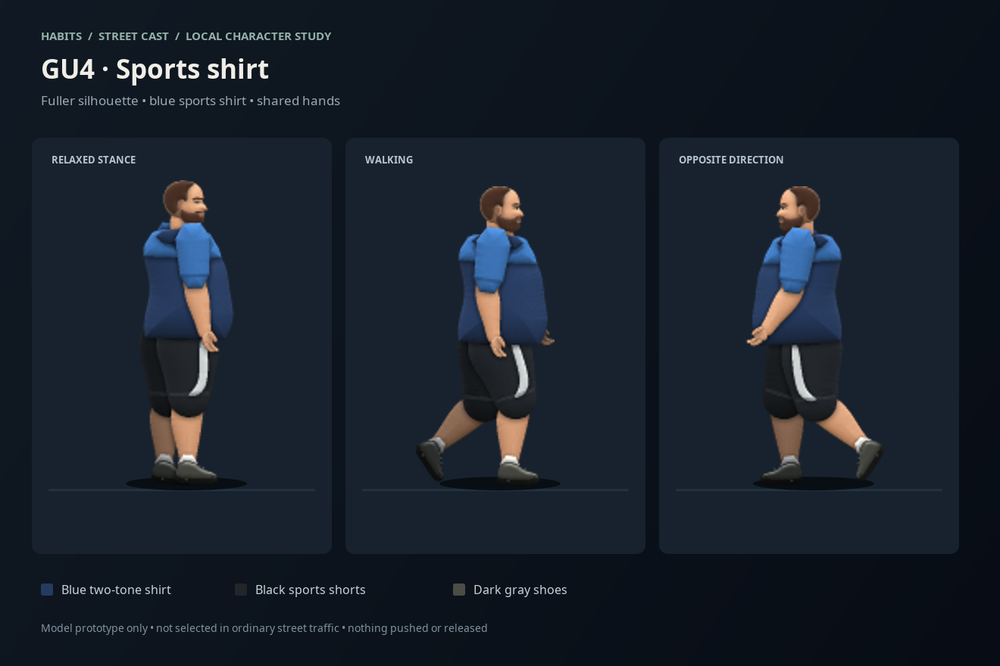

# GU pedestrian models — integration handoff

Five approved native pedestrian appearances, identified only as GU1–GU5. The branch contains
model geometry and tooling for integration; the models are not registered in ordinary city
traffic and no release or OTA is included.

| ID | Definition | Appearance |
| --- | --- | --- |
| GU1 | `StreetCameos.GU1` | Red striped shirt, green shorts, plain blue shoes, short dark crop |
| GU2 | `StreetCameos.GU2` | Blue plaid shirt, forward navy cap, long blond hair, olive cargo shorts |
| GU3 | `StreetCameos.GU3` | Green work shirt over red undershirt, beige trousers, brown shoes |
| GU4 | `StreetCameos.GU4` | Fuller build, blue/navy sports shirt, black shorts, gray shoes; no towel |
| GU5 | `StreetCameos.GU5` | Tall swept-up hair, green striped hoodie, khaki shorts, canvas bag, sandals |

## Source and integration

- Definitions: `android-wrapper/native/src/main/java/com/lifemax/rpg/feature/habits/domain/StreetCameos.kt`.
- Opt-in geometry, clothing, hair and shoes: `StreetRig.kt` in the same directory.
- `StreetRig.frame(StreetCameos.GU1, frame)` renders an explicit appearance without expanding the
  ordinary six-look cache. Each model has a custom calm gait and the same wrist-space hand size.
- All five match the approved previews, including GU2’s forward cap, GU3’s corrected chest
  pocket, GU4’s removed towel and GU5’s broad swept-up crown.
- Integrated (Habits street): the five walk the street together now and then as "the crew"
  (`domain/StreetCrew.kt`), with scripted beats (a shove, a story told walking backwards, a
  shoulder bump, a lag and a jog to catch up). Their looks are indexed after the ordinary six
  (`StreetLooks.of`), so the layered arm/head painter, shade and lamp compositing, night grade and
  shadows all use each one's own walk style and hand scale. Their sprites live in a separate cache
  that is made shortly before they come and released after they have gone. See the As built note
  in `docs/specs/HABITS_TAB_BRIEF.md`.

## Validation

The JVM scenario checks (`StreetGU1Scenarios`–`StreetGU5Scenarios`, run by `StreetGU1Test`–
`StreetGU5Test`) cover every pose, finite geometry, grounded and planted feet, restrained head
movement, matching hand dimensions, garment details, connected hairstyles and open sandals, and
that the six ordinary appearances are unchanged. `StreetCrewTest` covers the group in the live
street. The original standalone preview tool was not brought into the app repository.

## Approved appearance previews

### GU1

### GU2

### GU3

### GU4

### GU5

